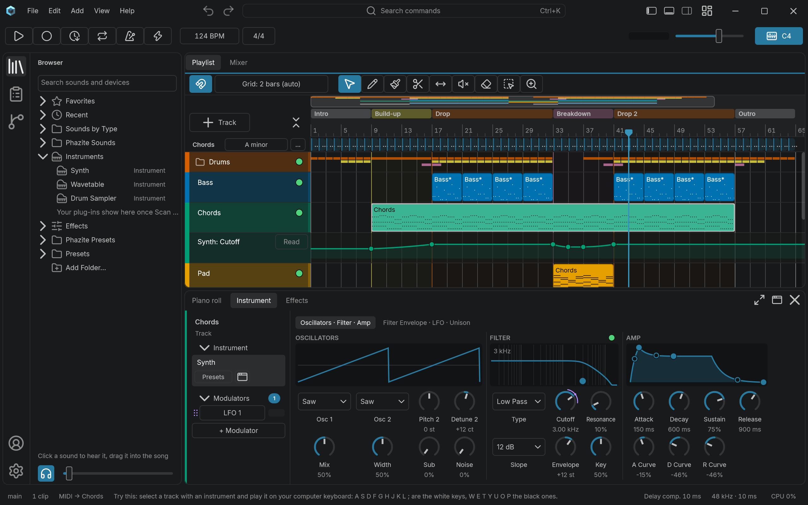

# Phazite

[](https://github.com/august-byrne/Phazite/actions/workflows/ci.yml)
[](LICENSE)
[](#status)

Phazite is a free, open-source digital audio workstation (DAW) for making beats and finishing songs. It is written in C++20 on [JUCE](https://github.com/juce-framework/JUCE), with its own playback engine, Windows first.



- **Clean and quick:** an uncluttered window, one clear way to do each thing, and the shortcuts of Phazite, FL Studio or Ableton Live.
- **Help for newcomers:** song outlines, a chord lane with chord progressions, example songs and lessons in the app, with chord suggestions and drum-sound generation planned after version 1 ([the design](docs/design.md)).
- **Lean and fast:** low CPU and memory use, in the audio engine and the UI.
- **Plug-ins:** VST®3 now; CLAP, and Audio Units on macOS, later.
- **Open source:** [AGPL-3.0-or-later](LICENSE).

## Status

**Pre-alpha.** There are no downloads yet, so you [build it yourself](#try-it). Projects saved now may not open in later builds.

What works today, on Windows:

- **Arrange:** a playlist of tracks, folders and clips, song sections and outlines, a chord lane with 40 progressions, automation lanes, and Cut, Copy, Paste and Undo throughout.
- **Write:** a piano roll with a drum mode, keys and scales, chord stamps and transforms; audio clips that follow the tempo, change pitch or play backwards.
- **Sound:** Phazite's own instruments (Synth, Wavetable, Drum Sampler) and effects (EQ, Filter, Compressor, Multiband, Limiter, Saturator, Delay, Reverb, Phaser, Flanger, Stereo Expander, Vocoder), and your VST3 plug-ins, each plug-in in a process of its own: one that crashes or hangs says so in its slot, with Reload, and Phazite plays on.
- **Mix:** a mixer with buses, sends, sidechains, effect containers, modulators and macros, freeze and bounce in place, and a loudness meter.
- **Record:** MIDI from a keyboard or the computer keyboard, audio from an interface (ASIO®) with count-in and punch-in, and Capture, which turns what you just played into a clip.
- **Finish:** export the song, or its stems, to WAV or FLAC, normalized to a loudness if you like.

The song plays, records, exports and freezes through Phazite's own engine, built on JUCE, and plug-ins run in Phazite's own helper processes.

The passes on performance and accessibility are done. Next come an installer and version 1; chord suggestions, the sound generator and a richer browser follow after it. The [roadmap](docs/roadmap.md) has the plan step by step.

| Platform | Status |
|---|---|
| Windows 11 x64 | Builds and runs: Phazite is developed here. |
| Linux, WSL2 (Ubuntu 24.04) | Builds and passes its tests in CI; the app itself hasn't been tried yet. |
| macOS | After version 1, with Audio Units. |

## Try it

You need Windows 11 x64 with about 15 GB free. Open PowerShell (not as administrator) and run:

```powershell
winget install --id Git.Git --exact --source winget --scope machine   # skip if "git --version" prints a version
# Close PowerShell and open a new window, then:
git clone https://github.com/august-byrne/Phazite.git C:\src\Phazite
cd C:\src\Phazite
tools\setup-windows.cmd   # installs the build tools: click Yes when Windows asks; restart Windows if it says so
```

Then, in a new PowerShell window:

```powershell
cd C:\src\Phazite
git submodule update --init --recursive --depth 1
cmake --preset windows-profile
cmake --build --preset windows-profile
build\windows-profile\Phazite_artefacts\RelWithDebInfo\Phazite.exe
```

The setup takes a few minutes to an hour, and the build a few minutes. [Building Phazite](docs/building.md) explains each step, has the instructions for Linux and WSL2, and a table of fixes for when something goes wrong.

## First steps

- The **Welcome** window that opens at the first start sets you up: your old DAW's shortcuts, a test sound, the free [Phazite Sounds](https://github.com/august-byrne/phazite-sounds) (85 public-domain drums, loops and effects) and a song to start from. **Help > Welcome** brings it back.
- **Help > Example Songs** opens a finished song to play and take apart; **Help > Lessons** walks you through making a beat, recording, arranging, effects and chords.
- **Space** plays and stops. **M** (Ctrl+T with FL Studio's shortcuts) turns the computer keyboard into a piano (A S D F G H J K L for the white keys, W E T Y U O P for the black ones), and a MIDI keyboard plays as soon as it is plugged in.
- **Ctrl+K** finds any command by name, and the bar along the bottom says what the control under the pointer does.
- **Options > Scan for Plug-ins** finds your VST3 plug-ins. If you hear nothing, choose your output in **Options > Audio Settings**.
- **Ctrl+S** saves (into `Documents\Phazite\Projects` at first), and **File > Export Song** renders it to a file.

## Get involved

Phazite is built in the open, and every kind of help counts:

- **Try it and say what tripped you up:** [open an issue](https://github.com/august-byrne/Phazite/issues) for a bug or an idea.
- **Help write it:** [CONTRIBUTING.md](CONTRIBUTING.md) covers setting up, how the code is laid out, its rules for the audio thread, the tests and the checks a change goes through.
- **See where it's going:** [the project board](https://github.com/users/august-byrne/projects/1) (the open steps, by month), [the roadmap](docs/roadmap.md) (the plan, step by step), [the design](docs/design.md) (what Phazite should be, and why) and [the known bugs](docs/known-bugs.md).

## License

Phazite is licensed under the [GNU Affero General Public License, version 3 or later](LICENSE). It builds on JUCE, Rubber Band Library and other open-source code: [docs/third-party.md](docs/third-party.md) lists each with its license.

VST is a registered trademark of Steinberg Media Technologies GmbH. ASIO is a registered trademark of Steinberg Media Technologies GmbH.
