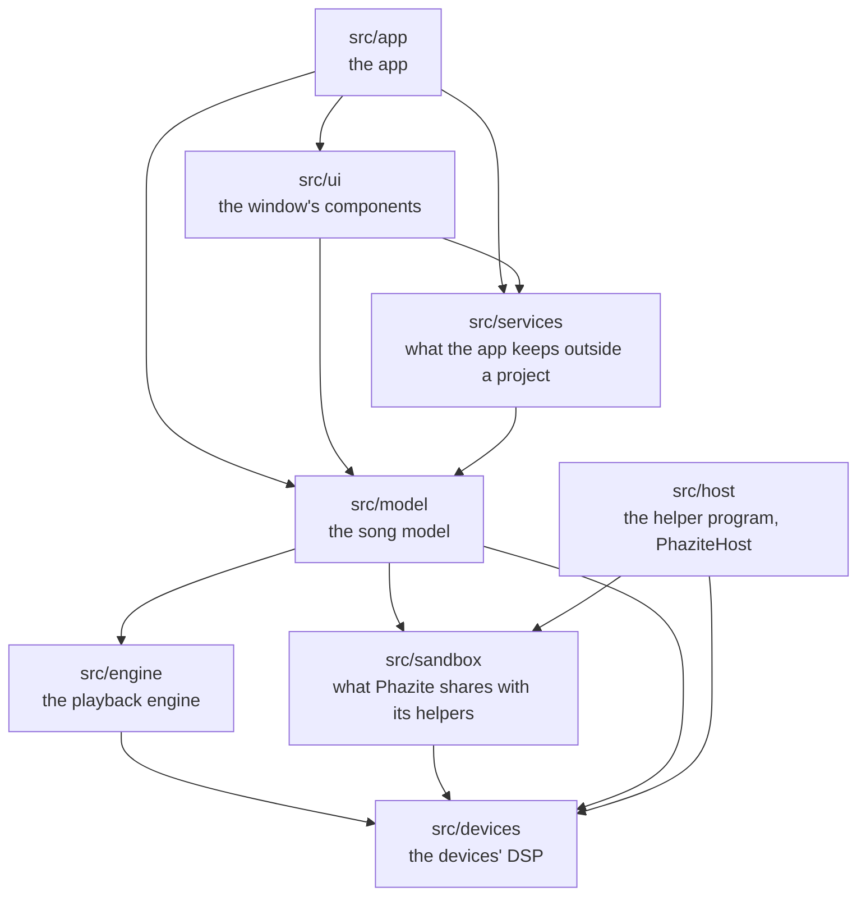

# Architecture

Phazite's code is in layers, so that the UI can change without touching the rules of editing, every edit can be tested
without a window, and a part of the engine could be replaced later. This page is the map of the layers and the rules
that keep them apart. Each source folder's `README.md` lists its files; [design section 24](design.md) says why the
structure was chosen.

## The layers

An arrow means "may include". Tests (`tests/`) and tools (`tools/`) may include anything.

Every layer may include `src/devices/`; the diagram leaves out the arrows from `src/app/`, `src/ui/` and `src/services/`
to it.

| Layer | May include | Built into |
|---|---|---|
| `src/app/` | `ui/`, `services/`, `model/`, `devices/` | `phazite_app` (a library the tests link) and the `Phazite` program (`Main.cpp`) |
| `src/ui/` | `services/`, `model/` (not its `internal/` headers), `devices/` | `phazite_ui` |
| `src/services/` | `model/`, `devices/` | `phazite_core` |
| `src/model/` | `engine/`, `sandbox/`, `devices/` | `phazite_core` |
| `src/engine/` | `devices/` | `phazite_core` |
| `src/sandbox/` | `devices/` | `phazite_core` |
| `src/host/` | `sandbox/`, `devices/` | `phazite_host`, and the `PhaziteHost` program |
| `src/devices/` | nothing of the others | `phazite_core` |

`phazite_core` compiles JUCE once for every program: only it links JUCE's module targets.

## What each layer is for

- **`src/app/`** creates everything and connects it: startup, the main window with its menus and dialogs, and the open
  project. It owns the services and hands them to what needs them.
- **`src/ui/`** is what the user sees and touches: the theme and its design tokens, the base controls, keys and keymaps,
  the device editors, and a folder for each view. It decides nothing about the project: it runs commands and calls model
  functions, by IDs.
- **`src/services/`** holds what the app keeps outside any project: the settings, recent projects, the browser's
  library, the Phazite Sounds download and the update check.
- **`src/model/`** is the song model, one folder per area: the song and its rules, the commands with undo, saving,
  versions, and the song compiled into what the engine plays. It has no window code, and each area keeps its insides in
  an `internal/` folder that the UI never includes.
- **`src/engine/`** is Phazite's own playback engine. It plays what the model compiles from the song, live on the audio
  device and offline in renders, and knows nothing of the song model.
- **`src/sandbox/`** is what Phazite shares with the helper processes that host plug-ins: shared memory, the channel a
  plug-in's blocks go through, and the control channel's messages.
- **`src/host/`** is the helper program, `PhaziteHost`, which hosts plug-ins in processes of their own, so that a
  plug-in that crashes can't take Phazite with it. Nothing includes it.
- **`src/devices/`** is the DSP of Phazite's own instruments and effects, the modulators and the stretcher, written so
  that it could run on another engine.

## How the song becomes sound

The song lives in the model (`src/model/base/Song.h`): its tree, and beside it its clips and their notes and
controllers' values as immutable values (`src/model/base/internal/SongValues.h`). Each open song has a playback session
(`src/model/playback/internal/PlaybackSession.h`), which compiles the song into a plan (`src/engine/core/Plan.h`)
through `SongPlayer` (`src/model/playback/internal/SongPlayer.h`), the notes read from their values, and gives the
engine a new plan as the song or its values change, at most once a turn of the message loop; values set by hand reach what plays at once, without a new plan. A plan is
built on the message thread and handed to the audio thread whole (`src/engine/core/Handover.h`); what sounds on from one
plan to the next, such as a reverb's tail or a fader, is kept by the song's IDs, so that a new plan doesn't reset it.
The engine (`src/engine/core/Engine.h`) plays each block from the audio device's callback, with worker threads for the
tracks' strips, and plays each device through a `DeviceRunner` (`src/engine/nodes/DeviceRunner.h`), which hands it the
audio, the notes and its parameters' values. Phazite's own devices run there as their DSP from `src/devices/`. A
plug-in runs in a helper process: its runner hands each block whole through the plug-in's channel in shared memory
(`src/sandbox/core/BlockChannel.h`), one round trip with a deadline, and the helper (`src/host/core/Instance.h`) plays
it on a thread of its own and answers in the same place, so that a plug-in that hangs makes only its own blocks late.
Exports, freezes and bounces compile the song the same way and play it offline, on an engine of their own
(`src/model/playback/internal/OfflineRender.h`).

## The rules

`CLAUDE.md`, "Architecture rules", states them in full. In short, with why each exists:

- **Dependencies point down**, as the table above says. Code that reaches up a layer ties the lower layer to the upper
  one, so that neither can change or be tested alone.
- **No window code below the UI.** The model, the services, the engine, the sandbox and the devices include no JUCE
  window module and name no window class, so that every edit and everything that plays can run without a window: in
  tests, on a headless CI machine, in a render.
- **The engine, the sandbox, the devices and the helper are engine-neutral.** They know nothing of the song model, so
  that a part of the engine could be replaced without rewriting the rest. The devices use JUCE's `juce_core`,
  `juce_audio_basics` and `juce_dsp` only; the engine those and r8brain-free-src; the sandbox `juce_core`,
  `juce_events` and `juce_audio_basics`.
- **The song's values stay in the model.** The immer library, which holds the song's areas as immutable values
  (`src/model/base/internal/ValueArea.h`), is included in `src/model/` alone (and the tests): what the layers above get of
  the song is Phazite's own types, so that how the model holds it can change without them.
- **The UI decides nothing about the project.** It runs a command or calls a model function, and a control changes a
  parameter through a `ParameterHandle`. Then the rules of editing are in one place, and a redesigned UI keeps them.
- **The model's insides stay in the model.** The UI includes no `internal/` header and passes Phazite's own types
  (IDs, plain values, handles) across, so that the model can change its insides without breaking the UI.
- **Every change to a project is one named undo step with one owner**: a command, or a model function that is a change
  of its own. Then Undo always takes back exactly what the user did, by a name the user recognizes.
- **View state is saved without an undo step** and doesn't count as an unsaved change: scrolling or folding a track is
  not an edit.
- **Every name saved in a project is defined once**, in `src/model/base/internal/Schema.h`, and Phazite saves its own
  values, never a library's enum numbers, so that a library's update can't change what a saved project means.
- **Settings go through `phazite::Settings`**, which lists every key once, with its default.
- **Colours, sizes, corner radii and fonts come from the design tokens**, so that a theme, or a designer, can change
  them in one place.
- **Values that change many times a second are polled**, never stored in the project or sent as change messages, and a
  display repaints only when what it draws moved, so that a quiet song costs nothing to show.
- **Whatever listens to a song listens to its root** (`Song::getState()`), never to one of its elements nor through a
  `juce::Value` of an element's property. The song's index, which finds tracks by their IDs, listens to
  the track list, and JUCE tells a change to the elements below first, so it hears of every change there before anything
  else can ask it about one.

`tools/check-architecture.sh` counts what breaks these rules, and more: includes that point up a layer, window modules
and classes below the UI, undo steps begun outside the undo code or in the UI, include loops in the model and the
services, `internal/` headers included in the UI, source files outside an area's folder, includes and CMake source paths
that name no file exactly, Tracktion Engine, threads ended by force, listeners on a song's elements rather than its root, immer's headers included
outside the model, and colours, font sizes and corner radii written
as literals in the UI rather than taken from the design tokens. It compares each count with its budget in
`tools/architecture-budget.txt`, where every budget is 0 but the literals', the count there was when that rule came,
which only falls; every count must equal its budget. CI and the pre-commit hook run it; run
`sh tools/check-architecture.sh` after changing `src/`, `tests/` or `CMakeLists.txt`. A budget goes up only when a
planned step moves code between layers on purpose, and the commit that raises it says why in an
`Architecture-Budget-Raise:` line, which CI and the pre-push hook check.

The script doesn't count everything: which JUCE modules the engine-neutral layers use, the undo steps' names and owners,
view state, the schema's names and the sizes the design tokens should hold beyond fonts and corners are kept by review
and by the tests (the golden files among them).
